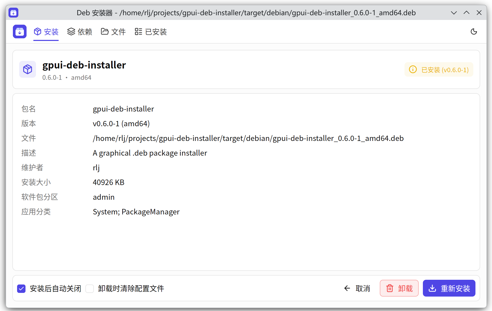
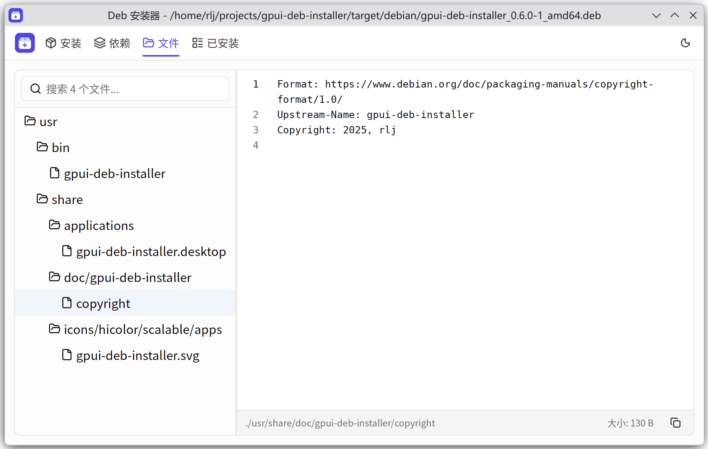

# GPUI DEB Installer 📦

[中文](README.zh-CN.md) | **English**

A fast, lightweight graphical installer for `.deb` packages, built with [GPUI](https://www.gpui.rs/) through `gpui-kit 0.7.3`.




## Features ✨

- **Refined workspace** — theme-aware cards, a single compact navigation bar and a scrollable detail panel with pinned install actions. Package status sits beside the summary, and file previews open directly without repeated page headings. Drop one `.deb` onto the welcome screen to open it; copy operation output and preview paths with one click. File previews include loading, empty, error and retry states. Redesigned parcel artwork gives the desktop icon and in-app identity the same indigo palette. A toolbar control switches between light and dark themes; uninstalling from package details now asks for confirmation.
- **Fast and fluid** — GPU-accelerated rendering via GPUI keeps the UI instantly responsive.
- **Full package details** — name, version, description, maintainer, installed size, dependencies and more.
- **Distinct categories** — package section (`Section`) and desktop app categories (`Categories`) are shown separately. App categories come from visible application entries inside the selected `.deb`; multiple entries are merged and deduplicated, and missing categories are shown as unknown.
- **Installed package management** — every package `dpkg` knows about, with search, sortable columns, install/update times and batch uninstall.
- **File preview** — inspect the contents of a `.deb` before installing it.
- **Desktop integration** — accepts a package path as a command-line argument, so a `.deb` can be opened straight from the file manager's context menu.
- **Safe privileges** — installs and removals run through `pkexec`, keeping every operation under PolicyKit control.
- **Optional configuration cleanup** — both the Install tab and the Installed tab let you choose whether to purge package configuration files when uninstalling. The option is off by default for each package; configuration in your home directory is unaffected.

## Installed packages 📋

The Installed tab reads `apt list` directly — the app no longer keeps its own install record, so it always matches what the system actually has.

- By default only packages that were installed locally (or that have vanished from every configured repository) are listed, via the `?installed ?obsolete` pattern. Turn on **Show repo packages** to list everything installed.
- Search by package name or version; click a column header to sort; drag column borders to resize (all spare width goes to the package name); long lists scroll virtually.
- Search, repository filtering, package counts and batch actions share a toolbar above the table. Select individual packages with the row checkboxes, or select all filtered packages with the checkbox in the package column header, then click **Uninstall selected**. Selections persist across searches and sorting, including packages hidden by the current filter; **Clear selection** clears them all. Refreshing or changing the repository toggle clears the selection. A centered confirmation dialog shows the package list and optional configuration cleanup before one `pkexec` authorization submits the batch to apt. The installed list refreshes after every removal attempt, including failures that may have removed some packages. After uninstall finishes, **Back** returns to the tab where the operation was started.
- Install and update times are parsed from `dpkg.log`, including rotated `.gz` logs. For packages whose log entries are already gone, the mtime of `/var/lib/dpkg/info/<pkg>.list` is used as a fallback, so a time may be missing.

## Requirements 🛠️

- **OS**: Linux (Debian-based distributions such as Ubuntu, Debian, Deepin, UOS)
- **Runtime**: `dpkg`, `apt`, `policykit-1` (`pkexec`)
- **Build**: Rust toolchain, `libvulkan-dev`, `libssl-dev`, `pkg-config`, `libwayland-dev` (when running under Wayland)

## Quick Start 🚀

### 1. Build and run

Make sure Rust is installed first.

```bash
# Run without loading a file
cargo run --release

# Run with a specific deb file
cargo run --release /path/to/your/package.deb
```

### 2. Desktop integration (development)

This workspace ships an `install-icon.sh` script that registers the context-menu entry and icon in your local desktop environment, without installing anything into `/usr/bin`.

```bash
chmod +x install-icon.sh
./install-icon.sh
```

After that you can **right-click a `.deb` file** in your file manager (Nautilus, Thunar, Dolphin, …) and choose **"DEB Installer"**.

### 3. Build a release DEB package

```bash
# Install cargo-deb
cargo install cargo-deb

# Build the .deb package
cargo deb
```

The generated package is written to `target/debian/gpui-deb-installer_*.deb`.
